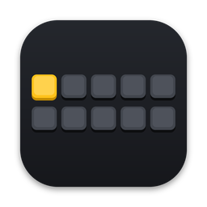

<p align="center">
  
</p>

<h1 align="center">Slotboard</h1>

<p align="center"><b>10 clipboard slots, zero clutter.</b><br>
⌘C + 1–0 to store, ⌘V + 1–0 to paste. Ctrl on Windows and Linux.</p>

<p align="center"><a href="https://github.com/markuskoppeberlin-a11y/slotboard/releases">Download</a> · <a href="ANLEITUNG.md">Anleitung (Deutsch)</a> · <a href="PRIVACY.md">Privacy</a></p>

---

## How it works

| | macOS | Windows & Linux |
|---|---|---|
| Store the selection in slot 1–0 | ⌘C, keep ⌘ held, tap a digit | Ctrl+C, keep Ctrl held, tap a digit |
| Paste slot 1–0 | ⌘V, keep ⌘ held, tap a digit | Ctrl+V, keep Ctrl held, tap a digit |

That's it. Without a digit, copy and paste work exactly as before. There are no pop-ups, no history window and no settings to learn. The menu bar icon lists your slots if you ever forget what is where; clicking a slot puts it on the normal clipboard.

Slots keep everything the normal clipboard holds – plain and formatted text, images, files and app-specific content such as Figma layers.

## Install

**macOS 11 or newer** – download `Slotboard_…_universal.dmg`, drag Slotboard into Applications and open it. The app is not notarized by Apple yet, so macOS asks once: open *System Settings → Privacy & Security* and click **Open Anyway**. Slotboard then walks you through allowing keyboard access (Accessibility).

**Windows 10/11** – run `Slotboard_…_x64-setup.exe`. Windows SmartScreen may warn about an unknown publisher: click **More info → Run anyway**.

**Linux (X11)** – install the `.deb` or run the `.AppImage`. Wayland sessions do not allow global shortcuts; log in with an X11 session.

## Privacy

Slotboard works completely offline. It only reacts to ⌘/Ctrl + C/V followed by a digit, never records keystrokes and keeps slots in memory only – they are gone when you quit. Passwords copied from password managers are ignored. Details in [PRIVACY.md](PRIVACY.md).

## Build it yourself

Requires [Rust](https://rustup.rs), [Node.js](https://nodejs.org) and the [Tauri prerequisites](https://tauri.app/start/prerequisites/).

```sh
npm install
npm run dev      # run locally
npm run build    # create installers in src-tauri/target/release/bundle
```

Every push to `main` builds installers for all three systems with GitHub Actions and attaches them to the *Testversion* release.

## Project layout

```
src-tauri/src/filter.rs      keyboard logic (platform independent, unit tested)
src-tauri/src/engine.rs      slots, paste, restoring the normal clipboard
src-tauri/src/platform/      macOS, Windows and Linux: keyboard hook + clipboard
src-tauri/src/tray.rs        menu bar / tray menu
ui/                          setup & help window
```

## License

[MIT](LICENSE) © 2026 Markus Koppe
